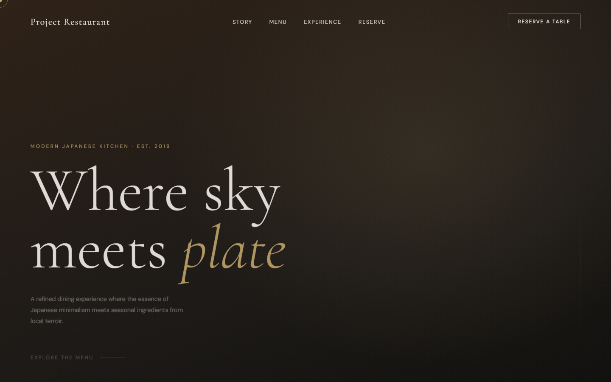
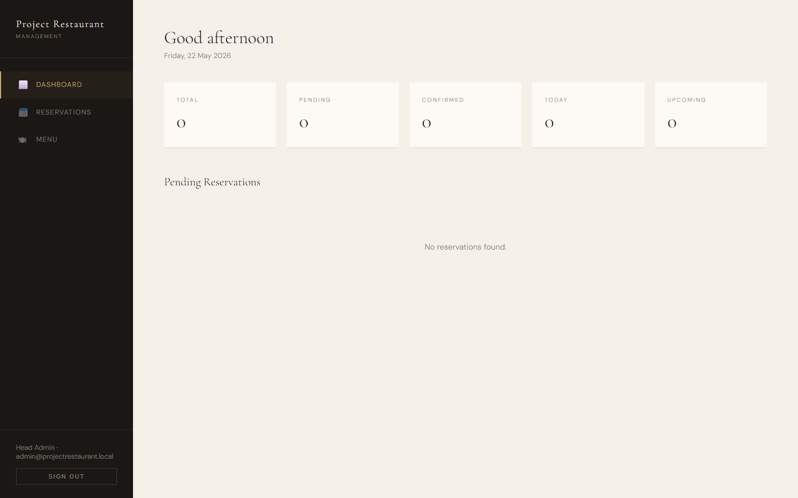
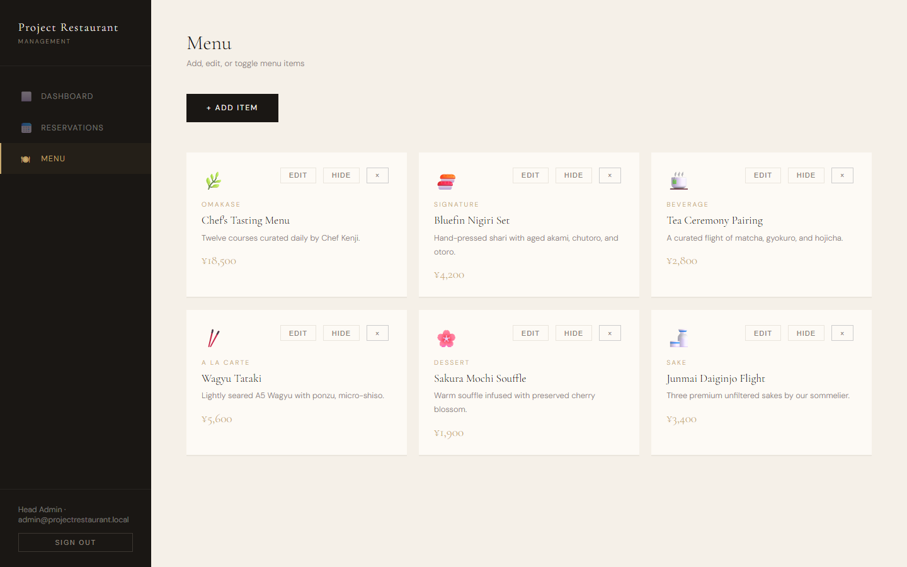

# Project Restaurant

A polished full-stack restaurant reservation demo with a public dining website, protected admin dashboard, menu management, email hooks, and a lightweight SQLite database powered by `sql.js`.



## Screenshots





## Features

- Public restaurant landing page with reservation form
- Express API for reservations, menu items, authentication, and health checks
- JWT-protected admin panel for reservations and menu management
- Reservation status workflow: pending, confirmed, cancelled, completed
- Email service integration with graceful mock mode when SMTP is not configured
- Local SQLite-style persistence using `sql.js`
- Security basics: Helmet, CORS allowlist, JSON body limits, and rate limiting

## Tech Stack

- Node.js
- Express
- sql.js
- JWT authentication
- bcryptjs
- Nodemailer
- HTML, CSS, and vanilla JavaScript

## Getting Started

Install dependencies:

```bash
npm install
```

Create your local environment file:

```bash
cp .env.example .env
```

On Windows PowerShell:

```powershell
Copy-Item .env.example .env
```

Start the app:

```bash
npm start
```

Open the website:

```text
http://localhost:3001
```

Open the admin dashboard:

```text
http://localhost:3001/index.html
```

Default demo admin credentials from `.env.example`:

```text
Email: admin@projectrestaurant.local
Password: ProjectRestaurantAdmin2024!
```

Change these values before deploying.

## API Overview

| Method | Route | Description |
| --- | --- | --- |
| `GET` | `/api/health` | Service health check |
| `POST` | `/api/reservations` | Create a public reservation |
| `GET` | `/api/menu` | List available menu items |
| `POST` | `/api/auth/login` | Admin login |
| `GET` | `/api/auth/me` | Current admin profile |
| `GET` | `/api/reservations` | Admin reservation list |
| `PATCH` | `/api/reservations/:id/status` | Update reservation status |
| `GET` | `/api/menu/admin/all` | Admin menu list |
| `POST` | `/api/menu` | Create menu item |
| `PUT` | `/api/menu/:id` | Update menu item |
| `PATCH` | `/api/menu/:id/toggle` | Toggle menu availability |

## Project Structure

```text
admin/                 Static customer and admin pages
routes/                Express route handlers
middleware/            JWT auth middleware
data/                  Local database directory
docs/screenshots/      README screenshots
db.js                  Database initialization and persistence
email.js               Nodemailer templates and send helpers
server.js              Express app entrypoint
```

## Notes

- `.env` and local database files are intentionally ignored by Git.
- `.env.example` documents the required configuration.
- If SMTP credentials are not configured, email sending falls back to mock log messages.
